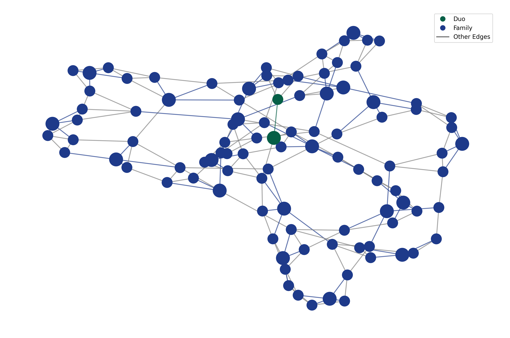

# Graph Licensing Optimization

**How cheaply can a group of friends buy software licences, when the cheap
family plan is only shareable with people you actually know?**

Spotify Family costs less per person than Spotify Individual — but only if you
can fill it, and only with people in your circle. Turn a friend group into a
graph and that becomes a combinatorial optimisation problem: given a friendship
network and a price list of licence types, buy the cheapest set of plans that
covers everybody.

This repository is the implementation and the full computational study behind an
M.Sc. thesis at Gdańsk University of Technology. It formalises the problem as an
extension of **domination in graphs**, proves it NP-hard, and then measures nine
algorithms — two exact, three constructive, four metaheuristic — across real
and synthetic networks, static and evolving.

<p align="center">
  
</p>

<p align="center">
  <sub>An optimal solution on a 100-node small-world graph under the Spotify price list.
  Note what the optimum actually looks like: almost everything collapses into Family
  groups, and only one isolated pair is cheaper as a Duo.</sub>
</p>

---

## The problem

You are given:

- an undirected graph `G = (V, E)` — people and who knows whom;
- a set of licence types, each with a **cost** and a capacity range
  `[min_capacity, max_capacity]`.

A **licence group** is an owner `i`, a licence type `t`, and a set of members
drawn from `N(i) ∪ {i}` whose size fits inside `t`'s capacity range. A
**solution** is a set of groups that covers every vertex exactly once. The
objective is to minimise the total cost of the groups bought.

```
minimise   Σ_i Σ_t  cost(t) · a[i,t]

subject to  Σ_{i ∈ N(j)∪{j}} Σ_t x[i,j,t] = 1                for every person j
            Σ_{j ∈ N(i)∪{i}} x[i,j,t] ≤ max_cap(t) · a[i,t]   for every owner i, type t
            Σ_{j ∈ N(i)∪{i}} x[i,j,t] ≥ min_cap(t) · a[i,t]   for every owner i, type t
            x[i,i,t] ≥ a[i,t]                                 an active group has its owner

            x[i,j,t] ∈ {0,1}   person j joins the group owned by i on licence t
            a[i,t]   ∈ {0,1}   that group is bought
```

### Why this is more than a pricing puzzle

The cost/capacity pair is a dial, and turning it walks through classical graph
theory:

| Price list | What the model becomes |
| --- | --- |
| `Solo = 1`, `Group = 2`, unbounded capacity | **Roman domination** |
| `Group` capacity capped at `k` | capacitated domination |
| One type, capacity `[1,1]` | trivial — everybody pays |
| Real tariffs (`duolingo_super`, `spotify`, `netflix`) | the practical case |

So the same solver answers a family of domination problems, and the price ratio
between solo and group plans decides which regime you are in. The thesis proves
NP-hardness by reduction from **Dominating Set**, and one of the study's
questions is where the optimum flips from mostly-solo to mostly-group as that
ratio moves.

---

## Algorithms

Nine implementations behind one `Algorithm` interface (`solve(graph,
license_types) -> Solution`), so every one of them is benchmarked through the
same harness and validated by the same `SolutionValidator`.

| Family | Implementation | Idea |
| --- | --- | --- |
| Exact | `ILPSolver` | the model above, solved with PuLP/CBC — the optimum, and the baseline everything else is measured against |
| Exact | `NaiveAlgorithm` | exhaustive search over partitions and owner/licence choices; exponential, so it only serves to confirm the ILP on tiny instances |
| Constructive | `GreedyAlgorithm` | repeatedly buy the group with the best cost-per-covered-person |
| Constructive | `DominatingSetAlgorithm` | build a cheap dominating set first, then give each dominator its cheapest legal group |
| Constructive | `RandomizedAlgorithm` | randomised construction, used as the population seed and as a control |
| Metaheuristic | `GeneticAlgorithm` | elitist population, tournament selection, group-merging crossover, neighbourhood mutation, greedy warm start |
| Metaheuristic | `TabuSearch` | neighbourhood search with a tabu list over group moves |
| Metaheuristic | `SimulatedAnnealing` | same neighbourhood, temperature schedule |
| Metaheuristic | `AntColonyOptimization` | pheromone over owner/licence choices |

Each has a companion note in [`docs/algorithms/`](docs/algorithms) with its
pseudocode, complexity and a line-by-line mapping onto the source.

---

## Headline results

From the thesis abstract, over the full study:

- **Metaheuristics reach roughly 88–90% of the ILP optimum** while cutting
  computation time by **about one order of magnitude** on the larger instances.
- On static instances **ant colony optimisation** was the best metaheuristic:
  cost `0.506` against the ILP's `0.445`, at `4.98 s` average against `73.83 s`.
- On evolving graphs the **genetic algorithm** gave the best quality-per-second:
  cost `0.409` against `0.362`, at `0.615 s` against `1.525 s`.
- Algorithms adapt well to topological change — re-solving a perturbed graph
  from a warm start is much cheaper than solving it cold.

Read that as the practical takeaway: if you need the true optimum, the ILP is
tractable up to a few hundred people. Past that, a metaheuristic buys you 88–90%
of the saving for a tenth of the compute, and on a network that keeps changing
that is the better trade.

Per-run CSVs for every experiment are committed under [`runs/`](runs), and every
figure in the thesis is generated from them by the scripts in
[`src/glopt/analysis/`](src/glopt/analysis).

---

## Datasets

**Real networks.** Ten Facebook ego networks from the
[SNAP ego-Facebook](https://snap.stanford.edu/data/ego-Facebook.html) dataset,
in `data/facebook/`. The benchmarked instances span **53 to 1035 nodes**, which
covers everything from a single dense friend group to a small community.

**Synthetic networks.** Three generator families, so the effect of topology can
be separated from the effect of size:

| Name | Generator | Models |
| --- | --- | --- |
| `scale_free` | Barabási–Albert | hubs and heavy-tailed degree |
| `random` | Erdős–Rényi | no structure, as a control |
| `small_world` | Watts–Strogatz | high clustering, short paths |

Plus `complete`, `cycle`, `path`, `star` and `tree` for edge cases and sanity
checks. Sizes run from 20 to 1000 nodes.

**Dynamic networks.** `DynamicSimulator` evolves a graph step by step —
preferential attachment, triadic closure, random rewiring — and re-solves at
each step, which is how the adaptability results were produced.

---

## Running it

Requires **Python 3.13** and [uv](https://docs.astral.sh/uv/).

```sh
git clone https://github.com/zbytek-team/graph-licensing-optimization
cd graph-licensing-optimization
uv sync                      # exact versions from uv.lock
uv sync --extra analysis     # additionally needed by `make analyze`
```

Each experiment is a `make` target:

```sh
make single             # one graph, one algorithm — prints cost and writes a PNG of the solution
make static-synthetic   # the synthetic benchmark sweep
make static-real        # the Facebook ego-network benchmark
make dynamic            # evolving-graph simulations
make pipeline           # everything, end to end
make analyze            # rebuild every figure and table from the run CSVs
```

Runs are written to `runs/<timestamp>_<name>/` as a CSV of results plus
optional solution renderings. To change what a run does, edit the constants at
the top of the corresponding module in `src/glopt/experiments/` — graph family,
node count, licence configuration and the algorithm list are all declared
there:

```python
GRAPH_NAME = "small_world"
N_NODES = 100
LICENSE_CONFIG_NAME = "spotify"
ALGORITHMS = ["ILPSolver", "GreedyAlgorithm", "GeneticAlgorithm"]
```

Built-in price lists are `duolingo_super`, `spotify`, `netflix` and
`roman_domination`, plus parameterised sweeps — `roman_p_1_5` sets the group
price to 1.5 so you can walk the solo/group ratio and watch the optimum change.

---

## How the code is organised

```
src/glopt/
├── core/
│   ├── models.py             LicenseType, LicenseGroup, Solution, Algorithm — the whole domain, frozen dataclasses
│   ├── license_config.py     named price lists and parameterised sweeps
│   ├── algorithms/           the nine solvers, one file each
│   ├── solution_builder.py   assembling and repairing groups
│   ├── solution_validator.py coverage and capacity checks; every result is validated before it is recorded
│   ├── mutations.py          the neighbourhood shared by the genetic algorithm and tabu search
│   ├── dynamic_simulator.py  graph evolution: attachment, triadic closure, rewiring
│   ├── run.py                one measured run: solve, time, validate, render
│   └── io/                   graph generation, SNAP loading, CSV output, visualisation
├── experiments/              the four studies plus the full pipeline
└── analysis/                 statistics and figure generation per study
```

Two decisions worth pointing out:

- **The domain is immutable.** `LicenseType`, `LicenseGroup` and `Solution` are
  frozen, slotted dataclasses that validate their own invariants in
  `__post_init__` — a group whose size violates its licence capacity cannot be
  constructed at all. Nine independent solvers therefore cannot disagree about
  what a legal solution is.
- **Measurement is separated from search.** Algorithms only implement `solve`.
  Timing, validation, CSV schema and rendering live in `core/run.py`, so adding
  an algorithm means adding one file and one name to a list, and it is
  immediately comparable with the other eight.

Analysis uses pandas, statsmodels and scikit-posthocs; figures use matplotlib
and seaborn.

---

## Thesis

The full text, including the complexity proof, the eight licensing-model
extensions and every results table, is in
[`docs/thesis/`](docs/thesis) — see
[`main.pdf`](docs/thesis/main.pdf) for the compiled document and
`chapters/` for the LaTeX sources.

## Authors

M.Sc. thesis by **Marcin Połajdowicz** ([@ack2406](https://github.com/ack2406))
and **Maciej Sztramski** ([@Birband](https://github.com/Birband)), Gdańsk
University of Technology, 2025.

The division of work is recorded in the thesis itself
(`docs/thesis/frontmatter/work_division.tex`):

- **Marcin Połajdowicz** — the overall project structure, the experiment and
  analysis modules, and the exact and constructive algorithms; all computational
  experiments, including the dynamic simulations and the licensing-model
  extension study; every figure and table in the results chapters, and the
  appendix.
- **Maciej Sztramski** — the logic and implementation of the metaheuristic
  algorithms, and the theoretical chapters introducing the model.
